<!-- ═════════════ ANIMATED HEADER ═════════════ -->

 

  

---

## 👨‍💻 About Me

<table align="center">
<tr>
<td width="58%" align="center" valign="middle">

</td>
<td width="42%" valign="middle">

### Hey, I'm Aditya 👋

I build **full-stack apps** and **AI-powered products**: from REST APIs and scalable backends to intelligent workflows that actually ship.

</td>
</tr>
</table>

---

## 🛠️ Tech Stack

<table align="center">
<tr>
<td width="55%" align="center" valign="middle">

</td>
<td width="45%" align="center" valign="middle">

**Languages** 
  

**Frontend** 
  

**Backend & Databases** 
  

**AI / ML** 
 
<code>Gemini API</code> · <code>Scikit-learn</code> · <code>XGBoost</code> · <code>NLP</code> · <code>LangChain</code>  

**DevOps & Tools** 

</td>
</tr>
</table>

---

## 🚀 Featured Projects

<table>
<tr>
<td width="50%" valign="top">

### 🤖 Nexora AI
AI-powered application with intelligent workflows, API connectivity and backend services.

`React` `TypeScript` `Node.js` `AI APIs`

[🔗 View Repository](https://github.com/adityaasinghhh?tab=repositories)

</td>
<td width="50%" valign="top">

### 🌐 INDIA ALL
Full-stack B2B commodity trading platform: product discovery, REST APIs, multilingual AI chatbot, enquiry workflows.

`MongoDB` `Express` `React` `Node.js`

[🔗 View Repository](https://github.com/adityaasinghhh/IndiaAll)

</td>
</tr>
<tr>
<td width="50%" valign="top">

### 🧬 Business Entity Matching
ML entity-resolution pipeline using normalization, intelligent blocking, feature engineering and XGBoost.

`Python` `Pandas` `XGBoost` `Scikit-learn`

[🔗 View Repository](https://github.com/adityaasinghhh/business-entity-matching)

</td>
<td width="50%" valign="top">

### ✈️ WanderLust
Full-stack travel platform for accommodation discovery, user interactions and booking workflows.

`JavaScript` `Node.js` `Express` `MongoDB`

[🔗 View Repository](https://github.com/adityaasinghhh?tab=repositories)

</td>
</tr>
</table>

---

---

## 📊 GitHub Stats

 

---

## 🐍 Contribution Snake

<picture>
  <source media="(prefers-color-scheme: dark)" srcset="https://raw.githubusercontent.com/adityaasinghhh/adityaasinghhh/output/github-snake-dark.svg" />
  <source media="(prefers-color-scheme: light)" srcset="https://raw.githubusercontent.com/adityaasinghhh/adityaasinghhh/output/github-snake.svg" />
  
</picture>

---

## 🌟 Thought of the Day 🌟

---

## 🤝 Connect With Me 🤝

&nbsp;

&nbsp;

&nbsp;

  

**Open to learning, collaboration, and exciting engineering opportunities.**

📫 **adityasinghjvm@gmail.com**

